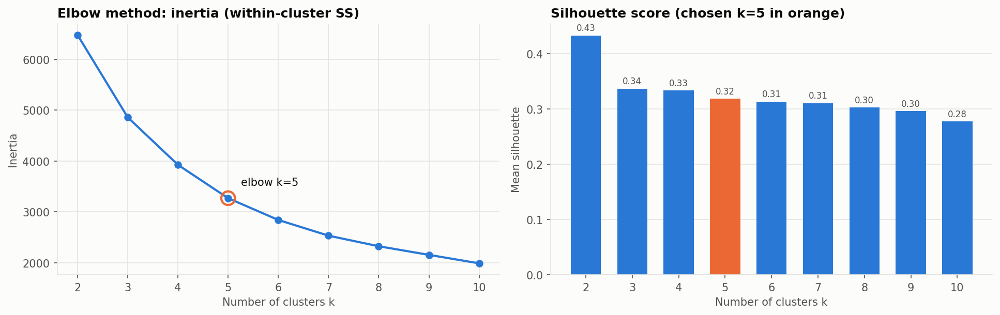
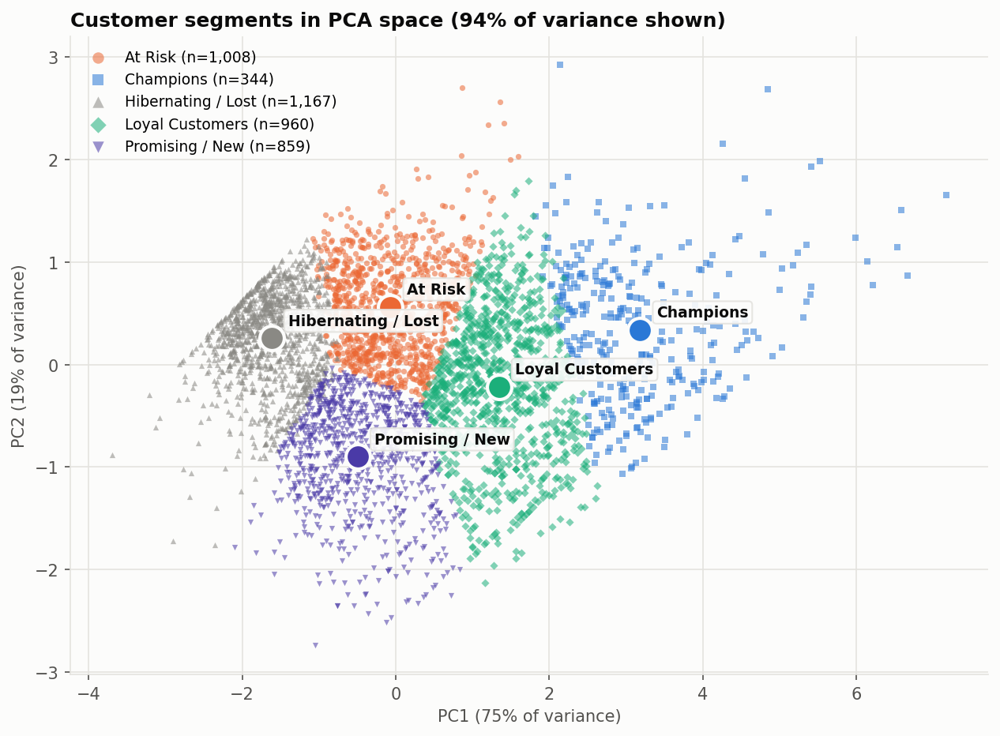
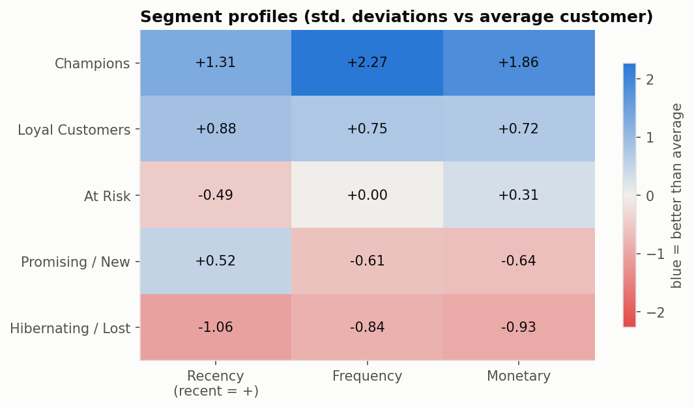
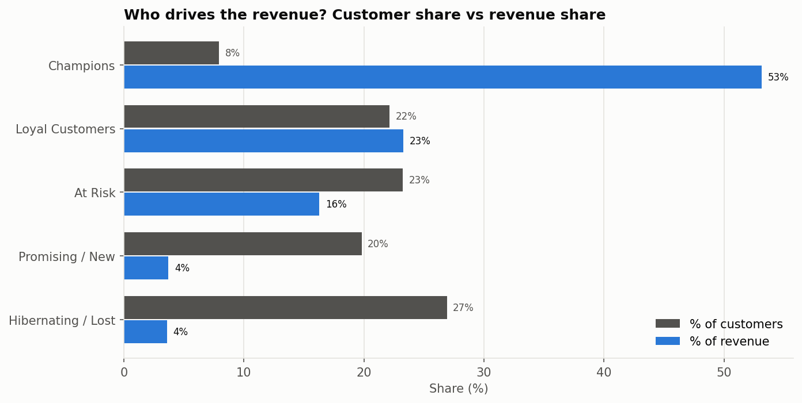

# Customer Segmentation with RFM + K-Means


Unsupervised segmentation of 4,338 customers of a UK online retailer into
groups the marketing team can act on – from raw transactions to named
segments with a recommended action for each.

**Skills shown:** data cleaning · EDA · feature engineering (RFM) · K-Means clustering ·
model selection (elbow + silhouette) · dimensionality reduction (PCA) · business interpretation

**Stack:** Python · pandas · scikit-learn · Matplotlib · Plotly

---

## Results

541,909 transactions (Dec 2010 – Dec 2011) were cleaned down to 392,692 rows from 4,338 identified
customers and grouped into **5 segments** (K chosen by the elbow method; silhouette = 0.32).
Full per-segment details and actions: [`reports/SEGMENTS.md`](reports/SEGMENTS.md).

| Choosing K | Segments in PCA space |
|---|---|
|  |  |

| Segment profiles | Revenue concentration |
|---|---|
|  |  |

### Key findings

| Segment | % of customers | % of revenue | Median days since last order | Median orders | Median spend |
|---|---:|---:|---:|---:|---:|
| Champions | 7.9% | 53.1% | 8 | 15 | £6,121 |
| Loyal Customers | 22.1% | 23.3% | 16 | 5 | £1,804 |
| At Risk | 23.2% | 16.3% | 82 | 3 | £1,001 |
| Promising / New | 19.8% | 3.7% | 25 | 1 | £351 |
| Hibernating / Lost | 26.9% | 3.6% | 216 | 1 | £242 |

- **Revenue is highly concentrated.** The 344 *Champions* (8% of customers) generate **53% of revenue**;
  together with *Loyal Customers*, 30% of the customer base drives **76% of revenue**.
  Retention perks for these two groups protect most of the business.
- **The biggest win-back opportunity is *At Risk*.** 1,008 customers (23%) who used to order regularly
  (median 3 orders, about £1,000 spent) haven't bought in a median of 82 days. They represent 16% of revenue,
  more than any group except the top two, and they were active recently enough to bring back.
- **Almost half the customers bring in very little.** *Promising / New* and *Hibernating / Lost* make up 47%
  of customers but only 7% of revenue, mostly one-time buyers. New customers need a second-purchase
  incentive; long-lapsed ones should only get low-cost automated campaigns.
- **Choosing K:** silhouette peaks at K = 2 (0.43), but that split is not actionable. The elbow is at K = 5,
  whose silhouette (0.32) is within 90% of the best for K ≥ 3, so 5 segments were kept.

## Approach

1. **Clean** 541,909 raw rows: drop rows without `CustomerID`, cancellations (`InvoiceNo` starting with `C`),
   non-positive quantity/price and duplicates.
2. **RFM features** per customer, relative to the day after the last transaction:
   - **Recency** – days since last purchase
   - **Frequency** – number of distinct invoices
   - **Monetary** – total revenue
3. **Transform:** `log1p` (all three are heavily right-skewed) then `StandardScaler`,
   so K-Means' Euclidean distance isn't dominated by a few wholesale buyers or by the Monetary scale.
4. **Choose K:** fit K = 2…10 and record inertia, silhouette, Davies–Bouldin and Calinski–Harabasz.
   The elbow is detected automatically (max distance to the chord, "kneedle"). Because silhouette on
   RFM data nearly always peaks at K = 2 (not actionable), K is chosen in 3…8 as the value closest to
   the elbow whose silhouette is within 90% of the best. Override with `--k`.
5. **PCA** to 2-D for visualization (plus loadings so the axes are interpretable).
6. **Interpret:** each centroid is placed on an *engagement* (recency) × *value* (frequency + monetary)
   plane and matched one-to-one to a familiar RFM persona – *Champions, Loyal Customers, Promising / New,
   Need Attention, At Risk, Can't Lose Them, Hibernating / Lost* – each with a recommended action.
   Results are cross-checked against classic 1–5 quintile RFM scores.

## Project structure

```
customer-segmentation/
├── main.py                        # run the full pipeline (CLI)
├── notebooks/
│   └── customer_segmentation.ipynb  # step-by-step analysis with commentary
├── src/segmentation/
│   ├── data.py                    # load + clean transactions
│   ├── rfm.py                     # RFM features, scaling, quintile scores
│   ├── clustering.py              # K evaluation, elbow, K-Means, PCA
│   ├── interpret.py               # cluster -> business segment + playbook
│   ├── plots.py                   # Matplotlib figures + optional Plotly HTML
│   ├── pipeline.py                # end-to-end orchestration + markdown report
│   └── synthetic.py               # fake data in the same schema (demo + tests)
├── scripts/download_data.py       # fetch the UCI dataset into data/raw/
├── tests/test_pipeline.py
├── data/raw/                      # dataset goes here (git-ignored)
├── data/processed/                # customer-level outputs (git-ignored)
└── reports/                       # figures, CSVs, SEGMENTS.md (committed)
```

## Quick start

Requires Python 3.10+.

Run each command separately, from the project folder.

**1. Create and activate a virtual environment** (on Windows the second line is `.venv\Scripts\activate`)
```bash
python -m venv .venv
source .venv/bin/activate
```

**2. Install dependencies**
```bash
pip install -r requirements.txt
```

**3. Optional: try it on synthetic data first** (no download needed; outputs go to `reports/demo/`)
```bash
python main.py --demo
```

**4. Get the real dataset (about 23 MB) and run the pipeline** (outputs go to `reports/`)
```bash
python scripts/download_data.py
python main.py
```

**5. Explore the notebook** (leaves Jupyter running in this terminal; press Ctrl+C twice to stop it)
```bash
jupyter notebook notebooks/customer_segmentation.ipynb
```

**6. Run the tests**
```bash
pytest -q
```

If the download script fails, get the file manually from
<https://archive.ics.uci.edu/dataset/352/online+retail> and save it as `data/raw/Online Retail.xlsx`.
The first run reads the Excel file (~1 min) and caches a CSV copy; later runs are fast.

### CLI options

| Command | What it does |
|---|---|
| `python main.py --k 4` | force 4 segments |
| `python main.py --country "United Kingdom"` | one market only |
| `python main.py --k-min 2 --k-max 12` | wider K search |
| `python main.py --data path/to/file.csv` | another file with the same columns |

### Outputs

| File | Contents |
|---|---|
| `reports/SEGMENTS.md` | human-readable summary: segments, sizes, revenue share, actions |
| `reports/segment_profiles.csv` | one row per segment with RFM medians/means and recommended action |
| `reports/k_selection_scores.csv` | inertia and validity scores for each K |
| `reports/figures/*.png` | 9 figures (EDA, K selection, silhouette, PCA, profiles) |
| `reports/interactive/*.html` | interactive Plotly 3-D RFM and PCA views |
| `data/processed/customer_segments.csv` | every customer with RFM values, cluster, segment, RFM scores |

## Pushing to GitHub

```bash
git init
git add .
git commit -m "Customer segmentation with RFM and K-Means"
git branch -M main
git remote add origin https://github.com/chourouk5885/customer-segmentation.git
git push -u origin main
```

Run `python main.py` on the real data **before** committing so the figures in
`reports/` appear in this README. Raw data and the customer-level CSV are git-ignored.

## Limitations & next steps

- RFM ignores *what* customers buy – adding product-category mix could split segments further.
- K-Means assumes roughly spherical, similar-size clusters; compare with Gaussian Mixture Models or DBSCAN.
- A single one-year window – rerun periodically to track how customers move between segments.
- The real validation of a segmentation is a campaign A/B test.

## Data

Chen, D. (2015). *Online Retail* [Dataset]. UCI Machine Learning Repository.
<https://doi.org/10.24432/C5BW33> – licensed CC BY 4.0.